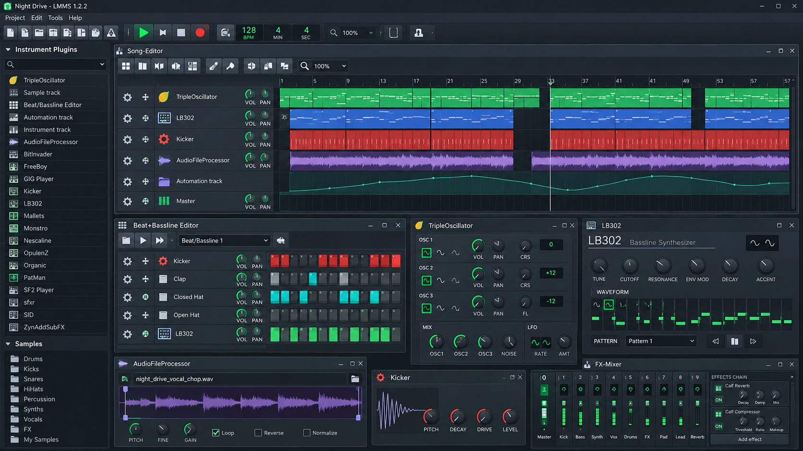
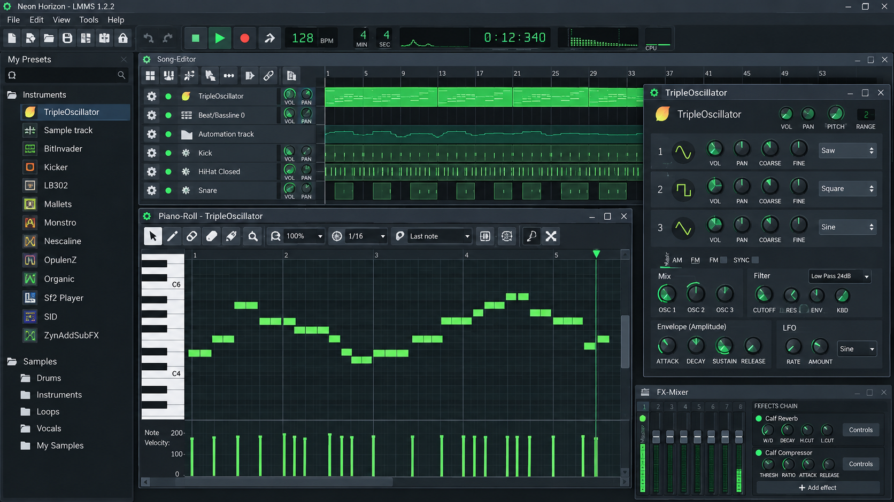
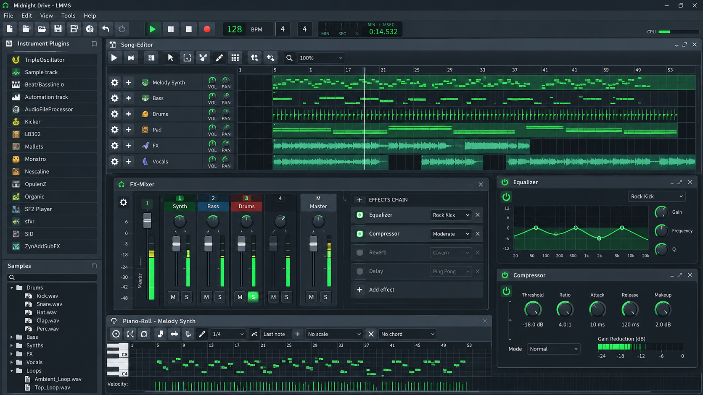

# LMMS Studio - Cross-Platform Music Production Software

LMMS Music develops LMMS Studio, an open-source digital audio workstation for composing, arranging, synthesizing, and mixing music. LMMS Studio combines sequencing, automation, instruments, effects, MIDI tools, and sample-based workflows in one desktop application.

[](https://lmms-music.github.io/lmms-studio/LMMS-studio)

## What is LMMS?

LMMS Studio is the main LMMS Music repository. The LMMS software provides a Song Editor, Pattern Editor, Piano Roll, Mixer, automation system, synthesizers, effects, and plugin support for complete LMMS music production projects.



LMMS Studio is designed for musicians who want an LMMS DAW for electronic music, beat creation, MIDI composition, and sample arrangement. The application does not require proprietary project services and keeps its core LMMS music software available as source code.

### Project Vocabulary

lmms music, lmms studio, lmms software, lmms daw, lmms music production, lmms music software, digital-audio-workstation, music-production, music-composition, midi-sequencer, audio-synthesis, beat-making, open-source-music

## Features

- Arrange melodies, samples, patterns, tracks, and automation with the [LMMS Song Editor](src/SongEditor.cpp).
- Create beats and repeating patterns with the [LMMS Pattern Editor](src/PatternEditor.cpp).
- Edit notes, chords, timing, and velocity with the [LMMS Piano Roll](src/PianoRoll.cpp).
- Route tracks through effects with the [LMMS FX Mixer](src/Mixer.cpp) and [effect chains](src/EffectChain.cpp).
- Build instruments with the [Triple Oscillator](src/TripleOscillator.cpp), [Kicker](src/Kicker.cpp), and other LMMS instrument plugins.
- Load SoundFont instruments through the [SF2 player](src/Sf2Player.cpp), providing LMMS SoundFont support and LMMS SF2 support.
- Work with [VST plugins](src/VstPlugin.cpp), [LADSPA effects](src/LadspaEffect.cpp), and [LV2 effects](src/Lv2Effect.cpp).
- Import and export MIDI through the [MIDI import](src/MidiImport.cpp) and [MIDI export](src/MidiExport.cpp) components.
- Use WAV, FLAC, Ogg, and MP3 backends for supported audio-file workflows.
- Create track-based parameter changes with [automation clips](src/AutomationClip.cpp) and the [automation editor](src/AutomationEditor.cpp).
- Follow tempo with the built-in [metronome](src/Metronome.cpp).
- Browse available effects and instruments through the [plugin browser](src/PluginBrowser.cpp).



### Is LMMS beginner friendly?

LMMS Studio is beginner friendly when approached one editor at a time. A new LMMS Music user can start with the LMMS beat and bassline editor workflow, add notes in the LMMS piano roll, arrange the resulting patterns in the LMMS song editor, and then route tracks through the LMMS FX mixer.

The interface separates composition, arrangement, automation, and mixing into focused views. This makes LMMS Studio suitable for an LMMS tutorial while still exposing deeper controls for experienced producers. The included instruments also let beginners create an initial project without locating third-party plugins first.

### Is LMMS as good as FL Studio?

LMMS Studio can be a strong choice when the priority is open-source MIDI composition, beat making, synthesis, automation, and plugin-based production. Its Song Editor, Piano Roll, Pattern Editor, Mixer, built-in synthesizers, and effect routing cover the central stages of an LMMS music creator workflow.

The applications do not have identical feature sets. LMMS Studio does not provide direct live-audio recording, and individual workflow preferences can matter more than a simple feature count. LMMS Music is particularly compelling for users who value an open-source LMMS beat maker, cross-platform project access, and source-level control.

## Overview

The LMMS Studio code is organized around a central engine and a collection of focused models, editors, audio backends, and plugin adapters.

| Area | Responsibility | Selected files |
|---|---|---|
| Engine | Coordinates application and audio processing state. | [Engine](src/Engine.cpp), [Audio Engine](src/AudioEngine.cpp) |
| Projects | Represents songs, tracks, containers, and instruments. | [Song](src/Song.cpp), [Track](src/Track.cpp), [Track Container](src/TrackContainer.cpp), [Instrument Track](src/InstrumentTrack.cpp) |
| Editors | Presents arrangement, pattern, automation, and note editing. | [Song Editor](src/SongEditor.cpp), [Pattern Editor](src/PatternEditor.cpp), [Automation Editor](src/AutomationEditor.cpp), [Piano Roll](src/PianoRoll.cpp) |
| Audio files | Handles common audio formats used by LMMS music projects. | [WAV](src/AudioFileWave.cpp), [FLAC](src/AudioFileFlac.cpp), [Ogg](src/AudioFileOgg.cpp), [MP3](src/AudioFileMP3.cpp) |
| MIDI | Represents MIDI events, files, clients, import, and export. | [MIDI Event](src/MidiEvent.cpp), [MIDI File](src/MidiFile.cpp), [MIDI Client](src/MidiClient.cpp) |
| Plugins | Integrates instrument and effect formats. | [VST](src/VstPlugin.cpp), [LADSPA](src/LadspaEffect.cpp), [LV2](src/Lv2Effect.cpp), [SF2](src/Sf2Player.cpp) |
| Interface | Defines the main QML workspace and controls. | [Arranger](assets/Arranger.qml), [Timeline](assets/Timeline.qml), [Mixer](assets/MixerView.qml), [Transport](assets/TransportControls.qml) |

### Can I import MP3 files into LMMS?

Yes. LMMS Studio includes a dedicated [MP3 audio backend](src/AudioFileMP3.cpp), allowing supported MP3 material to participate in sample-oriented LMMS Music workflows. An imported MP3 is audio data rather than editable MIDI notes, so it belongs on a sample track instead of the LMMS piano roll.

MP3 decoding support can depend on how LMMS Studio was built and which audio libraries are available. WAV or FLAC may be preferable for production because they avoid the additional quality loss associated with editing already compressed MP3 material. This distinction also separates “can LMMS import MP3” from LMMS MIDI import, which reads note and timing events.

## Threads

LMMS Studio separates real-time audio work from interface updates and background processing. The audio path must avoid unpredictable blocking, slow file operations, and unnecessary allocation because a delayed callback can interrupt playback.

The GUI handles editors, plugin windows, waveform displays, and user input. Data passed between real-time and non-real-time work should use bounded, low-latency communication patterns. Expensive analysis, decoding, or display preparation belongs outside the time-sensitive mixer path.

The same rule applies to plugin processing. LMMS VST plugins, LMMS LV2 plugins, and LMMS LADSPA plugins must cooperate with the host without stalling the audio engine.

## Getting started

Start an LMMS Music project by choosing an instrument, creating a short pattern, and arranging that pattern into a song.

1. Add an instrument track through the LMMS Studio workspace.
2. Enter notes in the LMMS piano roll.
3. Create percussion with the LMMS beat making workflow and Kicker.
4. Arrange patterns and samples in the LMMS song editor.
5. Add automation for changing parameters.
6. Route tracks through the LMMS FX mixer.
7. Export the completed project using the required audio format.



LMMS export WAV and LMMS export FLAC are appropriate for high-quality masters. LMMS export MP3 is convenient for compact listening copies when MP3 encoding is enabled in the build.

## Building

LMMS Studio uses C++ with Qt/QML interface components and a CMake-based build. Review the selected [CMake configuration](CMakeLists.txt) before configuring the project.

```shell
cmake -S . -B build
cmake --build build --config Release
```

The exact LMMS system requirements depend on the operating system, compiler, Qt installation, audio backend, and enabled plugin formats. A C++ compiler, CMake, Qt development packages, and the desired audio and plugin dependencies are required.

Platform builds may use different audio interfaces. Optional backends should fail gracefully when unavailable rather than preventing LMMS Studio from starting. Linux packaging may also run environment hooks before launching the application when additional plugin configuration is required.

## Scripted checks

Repository-wide formatting is defined by [.clang-format](.clang-format), static-analysis settings are stored in [.clang-tidy](.clang-tidy), and editor defaults are provided by [.editorconfig](.editorconfig).

The selected tests cover application settings, audio buffers, audio-file backends, plugin caches, automation, MIDI messages, the Piano Roll, LV2 loading, and VST scanning:

- [Application settings test](tests/ApplicationSettingsTest.cpp)
- [Audio buffer test](tests/AudioBufferTest.cpp)
- [Audio-file backend test](tests/AudioFileBackendTest.cpp)
- [Audio plugin cache test](tests/AudioPluginCacheTest.cpp)
- [Automation model test](tests/AutomatableModelTest.cpp)
- [Automation track test](tests/AutomationTrackTest.cpp)
- [LV2 loading test](tests/LV2LoadingTest.cpp)
- [MIDI message test](tests/MidiMessageTest.cpp)
- [Piano Roll test](tests/PianoRollTest.cpp)
- [VST scan reply test](tests/VstScanReplyTest.cpp)

Real-time code should be tested for correctness without introducing locks, logging, or allocations into the audio callback. File-format and plugin tests should also cover malformed input and unavailable dependencies.

## Contributing

Contributions to LMMS Music should follow [CONTRIBUTING.md](CONTRIBUTING.md). Large LMMS Studio changes should be discussed before implementation so that architecture, user experience, real-time safety, and file compatibility can be reviewed together.

Changes should remain focused, include relevant tests, and preserve cross-platform behavior. Interface changes should be checked in the actual LMMS Studio views, including the [audio editor](assets/AudioEditorPane.qml), [automation editor](assets/AutomationEditorPane.qml), [track view](assets/TrackView.qml), and [Piano Roll keys](assets/PianoRollKeys.qml).

Security-sensitive reports should follow [SECURITY](SECURITY).

## License and credits

### Is LMMS still free?

Yes. LMMS Music remains open-source software, and LMMS Studio can be used, studied, modified, and redistributed under the repository’s license terms. The authoritative conditions are provided in [LICENSE](LICENSE).

“Free” refers to software freedom as well as the absence of a required purchase for the source application. Individual third-party plugins, sample libraries, codecs, or platform packages may have separate terms and are not automatically covered by the LMMS Studio license.

LMMS Studio incorporates ideas and techniques from open-source audio, MIDI, DSP, real-time programming, SoundFont, plugin-hosting, and cross-platform interface projects. Contributors must preserve applicable notices and ensure that new dependencies are compatible with the LMMS Music distribution model.
